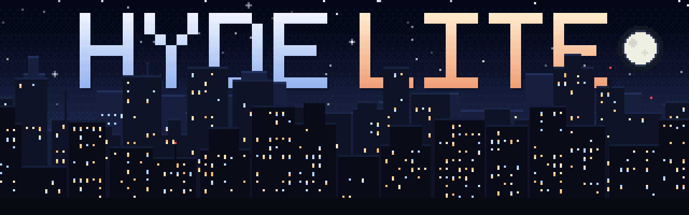
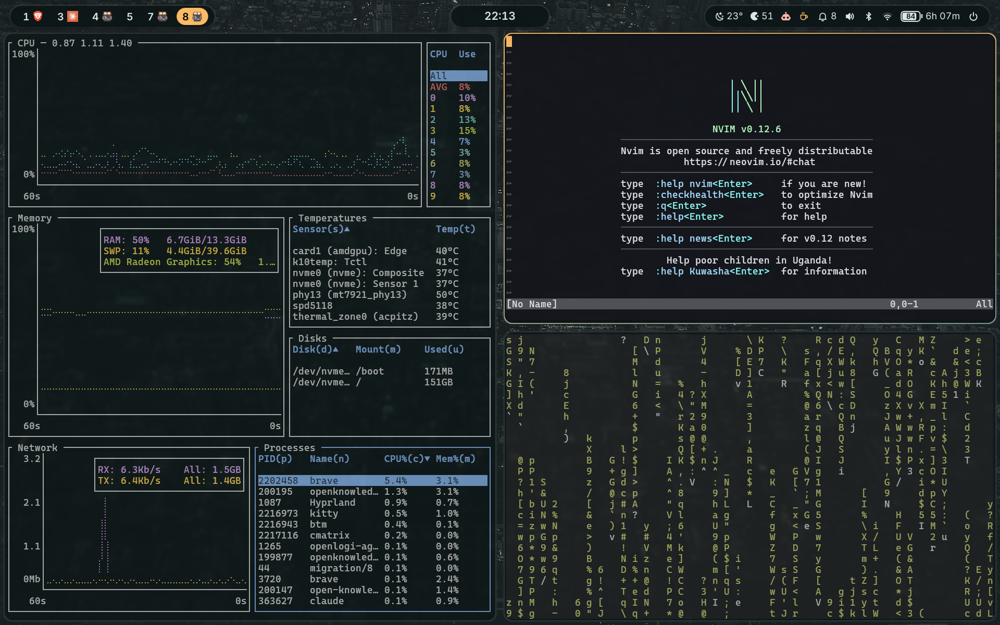
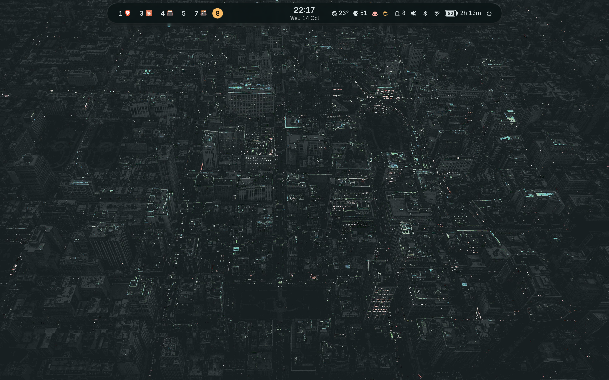
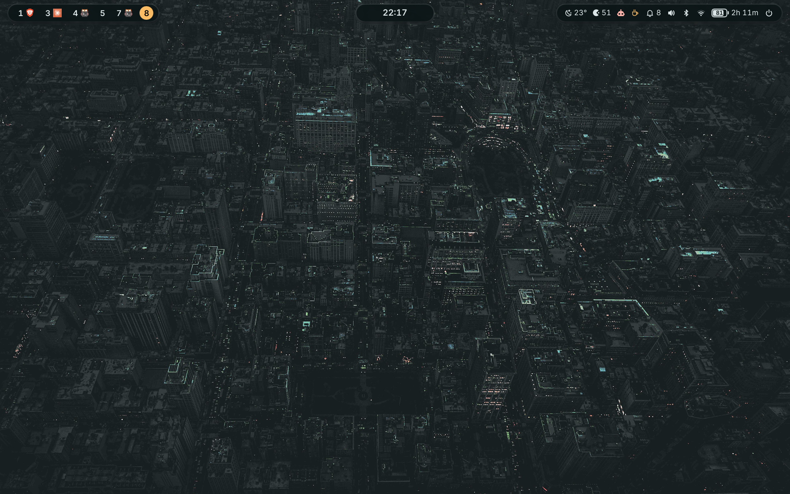
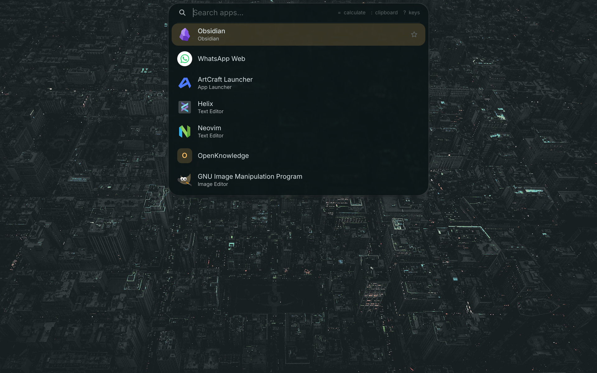
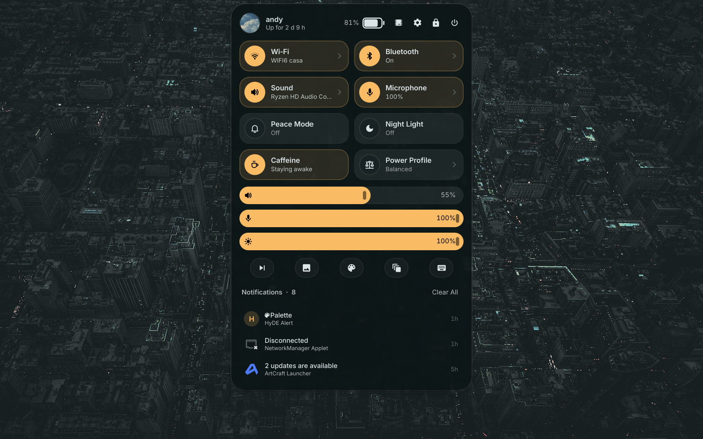
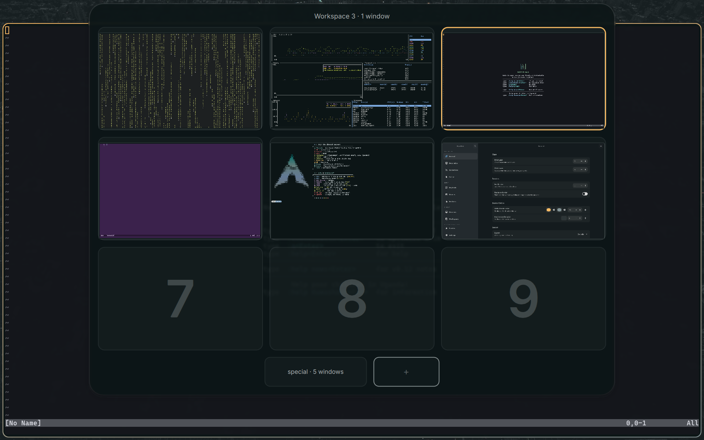
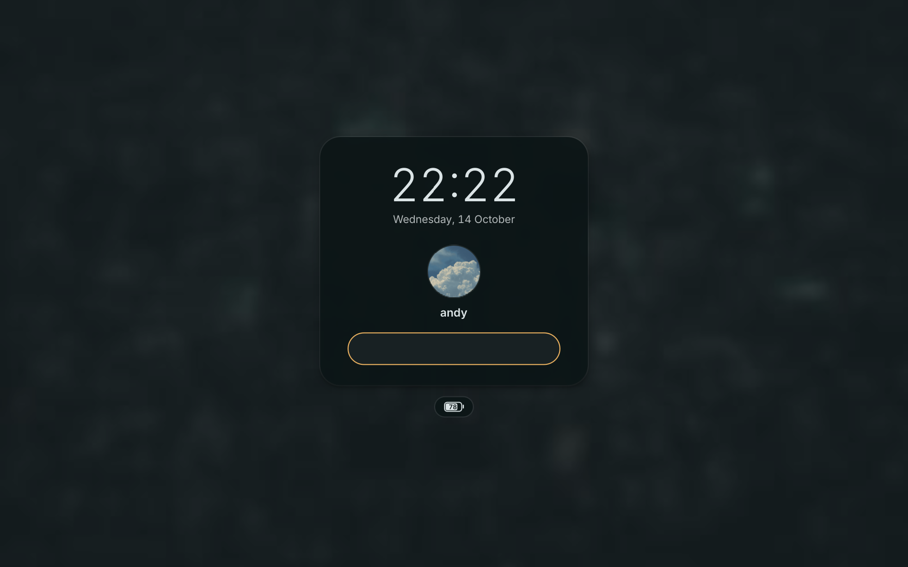
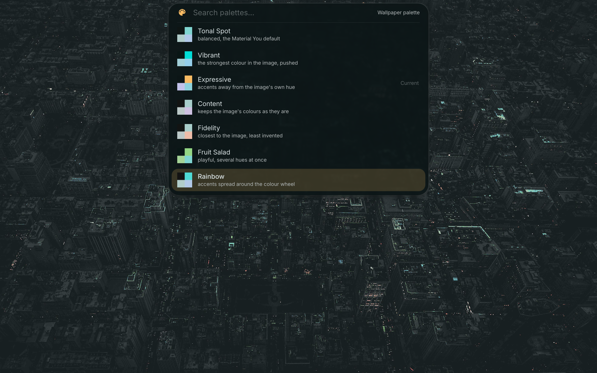
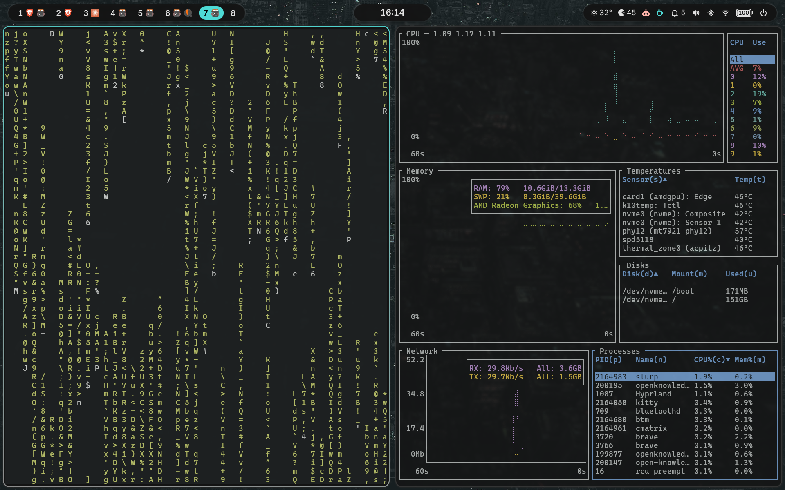

<div align="center">



**HyDE without the clutter.** Hyprland on Arch Linux, two hand-made Quickshell shells and one colour
pipeline, installed with one command.

[](LICENSE)
[](https://github.com/HyDE-Project/HyDE)


[Install](#install) · [What you get](#what-you-get) · [Colour](#colour) · [Build your own bar](#build-your-own-bar) · [Contributing](#contributing)

</div>

> [!NOTE]
> hyde-lite is a **fork of [HyDE](https://github.com/HyDE-Project/HyDE)**, the Hyprland desktop by the HyDE Project
> and its contributors, which itself continues [hyprdots](https://github.com/prasanthrangan/hyprdots). It is cut
> down to what a Quickshell desktop needs and extended with its own shells. It is an independent project, not
> affiliated with or endorsed by HyDE, and it keeps HyDE's GPL-3.0 licence. See [Credits and licence](#credits-and-licence).

## Why

- **Less of everything.** One base theme instead of twelve. Waybar, rofi, dunst, swaync and the other
  programs a shell replaces are not installed. Every difference from upstream is listed in
  [`LITE.md`](LITE.md), so staying close to HyDE stays possible.
- **Two shells, one choice.** The **Morphing Island**: a single pill that expands into the launcher,
  control centre, notifications, lock screen and more. Or the **bar shell**: a classic bar made of pills,
  with ready layouts and an editor. Pick one at install time and switch whenever you like.
- **One source of colour.** [matugen](https://github.com/InioX/matugen) colours everything from the
  wallpaper: you choose a scheme and a mode (auto, dark or light), and HyDE's own colour flag is written
  from the same values, so the two never disagree.
- **One command.** From a barebones Arch Linux to a working desktop, safe to run again.

|  | HyDE | hyde-lite |
|---|---|---|
| Themes | twelve | one base theme (Nordic Blue) |
| Bar, launcher, notifications, logout | waybar, rofi, dunst, swaync, wlogout | two Quickshell shells |
| Colour | wallbash, taken from the image | matugen, with HyDE's templates fed from it |
| Install | HyDE's installer and its questions | `./install.sh`, no questions |

## What you get

<div align="center">


</div>



| | Morphing Island | Bar shell |
|---|---|---|
| Look | one floating pill per screen that morphs between states | bar of pills, islands or one strip, top or bottom |
| Launcher, clipboard, calculator, pickers | yes | yes |
| Control centre, notifications, OSD | yes | yes |
| Workspace overview and notepad | yes | no |
| Screenshots | with Copy, Save, Edit and Delete | HyDE's screenshot tool |
| Lock screen and login screen | yes, the island's own | the same ones, with a fade instead of the pill |
| Layouts and editor | one fixed design | seven layouts, a layout file and an in-shell editor |

| | |
|:---:|:---:|
|  |  |
| Everything in one strip | Workspaces, clock and status in separate pills |
|  |  |
| Launcher (`Super+A`) | Control centre (`Super+Alt+C`) |
|  |  |
| Workspace overview (`Super+D`) | Lock screen (`Super+L`) |

<!--  -->

Both UIs are written in QML on [Quickshell](https://quickshell.org) and are one configuration,
`Configs/.config/quickshell`: the island in `island/`, the bar in `bar/`, and `shell.qml` loads the one that is
active. Only one runs at a time.

## Requirements

- Arch Linux (or a derivative with `pacman`), freshly installed or not, with a normal user that has `sudo`.
- An internet connection. The installer fetches packages with `pacman` and the AUR.
- A GPU Hyprland supports. Nvidia needs `--nvidia`. Nothing else about your hardware is assumed.

## Install

On a barebones Arch Linux, as a normal user with `sudo` and an internet connection:

```sh
git clone https://github.com/andyjamesf/hyde-lite
cd hyde-lite
./install.sh
```

The installer runs HyDE's own installer in separate steps (packages, configs and themes, login screen and
shell, services), installs the fonts the shells need and checks them, and at the very end asks which shell
to start with. It carries on when a step fails and prints a summary of what is left to do by hand. Logs
go to `~/.local/state/hyde-lite-install/`. It is made for a generic PC: it knows none of your apps and
assumes no hardware; monitors and GPU are left to Hyprland's detection. Then log out and pick the Hyprland
session, or reboot.

<details>
<summary><b>Installer options</b></summary>

<!--  -->

| Option | Effect |
|---|---|
| `--island` / `--bar` | pick the first shell without being asked (without either, it asks at the end; with no terminal it picks the island) |
| `--dry-run` | show what would happen, change nothing |
| `--nvidia` | also install the Nvidia driver when an Nvidia GPU is found |
| `--shell zsh\|fish` | login shell to set up (default zsh) |
| `--aur-helper NAME` | AUR helper to build (default `yay-bin`) |
| `--no-services` | do not enable system services |
| `--interactive` | let HyDE's installer ask its questions |

</details>

### Updating

`hyde-lite update` brings the installed system up to date with its checkout:

```sh
hyde-lite update              # pull (fast-forward only), run the installer again, say what to reload
hyde-lite update --check      # only say whether there is something to install
hyde-lite update --restart    # also reload Hyprland and restart the shell when the update changed them
```

It lists the new commits, pulls `main`, runs `./install.sh` for the shell you use now (`--island` or `--bar`,
so the installer does not ask again) and reports what to load afterwards: `hyprctl reload` if the Hyprland
configuration changed, and `island off && island on` (island) or `qs ipc call shell reload` (bar) if the
shells changed. It asks for `sudo` once, for packages.

It stops without changing anything when the checkout has changes of its own, is not on `main`, or has diverged
from `origin/main`. The installer redeploys only the dots whose content changed and does not overwrite what is
yours: your `hyprland.lua`, the settings in `bar/config` and `island/config`, `prefs.json` and your wallpapers.
Before it replaces a file it saves the old one under `~/.local/share/deez/backup/`.
`install.sh` records the checkout and the last commit it installed completely in `~/.local/state/hyde-lite/`,
so an update whose installer failed half-way runs again next time even when git has nothing new.

By hand it is `git pull --ff-only` followed by `./install.sh --island --no-services` (or `--bar`).

In the island, Settings has a "hyde-lite" row: it checks for news when the screen opens (`Check` does it again) and
`Update` opens a terminal that runs `hyde-lite update --restart`, where `sudo` asks for your password. The
installer's package step needs `sudo`, which the island's own password prompt (polkit) does not answer, so the
password is typed in that terminal, which also shows the progress and any error. The terminal runs in its own unit,
so the shell restart that ends the update does not close it.

## Using it

A few keys to start with (`Super` is the main modifier; [`KEYBINDINGS.md`](KEYBINDINGS.md) has the rest,
and `Super+\` lists them on screen):

| Key | Does |
|---|---|
| `Super+A` | launcher (type `=` for a calculator, `:` for clipboard history, `?` for keybindings) |
| `Super+L` | lock the screen |
| `Super+Alt+C` | control centre |
| `Super+D` | workspace overview (island) |
| `Super+Shift+W` / `Super+Shift+T` | wallpaper and theme pickers |
| `Super+Shift+C` | colour scheme of the current wallpaper |
| `Super+Shift+D` | light, dark or auto |
| `Super+Alt+I` | switch between the island and the bar shell |

### Colour

`wallpaper-palette list|set|next|prev` chooses among the schemes matugen offers for the current wallpaper;
`wallpaper-library next|prev|random` walks the whole wallpaper collection (a small starter set is copied to
`~/Pictures/Wallpapers` on first install: pixel-art night cityscapes, see
[`Wallpapers/SOURCES.md`](Wallpapers/SOURCES.md)). One change recolours the shell, the terminal, GTK and the rest
of HyDE's templates; the slow template rebuild runs in the background.

Wallpapers of installed HyDE themes show up in that folder as links; `wallpaper-library --own` turns them into files of
the folder (hard links, no extra space), so they stay if a theme is removed.

The picture Hyprland shows before a wallpaper daemon has started is one of three files of its package; `sudo hypr-default-wallpaper
install` points them at your current wallpaper (and re-does it after each `hyprland` upgrade), `uninstall` puts the originals back.



### Build your own bar

With the bar UI, a bar is data: zones (left, centre, right) of pills, each pill a list of widgets.
Open the editor with `qs ipc call bar edit`, or write `~/.config/quickshell/layouts.json` by hand; the
file is validated and reloaded while the shell runs. See [`docs/bar-builder.md`](docs/bar-builder.md).

<!--  -->



## Status

> [!NOTE]
> hyde-lite is young. The installer has been run twice in a clean Arch container and once in a clean Arch
> virtual machine (all steps exit 0), with Hyprland, both shells and matugen working, and the repository
> checks and unit tests (`bash tools/check.sh`) run on every push by CI.
>
> Not yet seen on a real screen: the bar editor, the lock and login screens with the fade entry, and the
> installer's shell choice. Real hardware has not been tried. Please open an issue if something breaks on
> yours; the bug template asks for what is needed.

## Contributing

Small, focused changes are welcome. [`CONTRIBUTING.md`](CONTRIBUTING.md) explains how to run the checks,
what to include in a pull request and the one rule that matters most for a fork: keep the difference from
upstream HyDE small, and write it down in [`LITE.md`](LITE.md).

```sh
bash tools/check.sh      # shell syntax, Python, TOML/JSON, dots includes, bar layouts, unit tests, qmllint
```

`qmllint` needs Qt 6.5 or newer and the `quickshell` package; without them that step is skipped.

| File | What it is |
|---|---|
| [`LITE.md`](LITE.md) | every deviation from upstream HyDE, and why |
| [`docs/bar-builder.md`](docs/bar-builder.md) | layout schema, widget list, how to add a widget |
| [`docs/island-features.md`](docs/island-features.md) | inventory of the Morphing Island's features |
| [`KEYBINDINGS.md`](KEYBINDINGS.md) | all keybindings |
| [`docs/weight.md`](docs/weight.md) | what the repository and an install weigh |
| [`docs/architecture.md`](docs/architecture.md) | how the code is layered, where it leaks, what to refactor first |
| [`docs/island-builder.md`](docs/island-builder.md) | arranging the island: icon lists, extra pills, the Settings editors |
| [`docs/troubleshooting.md`](docs/troubleshooting.md) | a shell using too much CPU: how to catch it and read its log |

## Credits and licence

hyde-lite stands on [HyDE](https://github.com/HyDE-Project/HyDE) by the HyDE Project and its
[contributors](https://github.com/HyDE-Project/HyDE/graphs/contributors), cut at upstream commit `aceb94ee`, and on
[hyprdots](https://github.com/prasanthrangan/hyprdots) before it. Like HyDE it is licensed under the
**GNU GPL v3.0** ([`LICENSE`](LICENSE)); keep that file and [`CREDITS.md`](CREDITS.md) when you redistribute it.

- [`THIRD_PARTY.md`](THIRD_PARTY.md) lists code from other projects with its own notice and the assets that came
  with HyDE whose licence is not verified.
- The starter wallpapers, the logo and the banner above are original and released under
  [CC0 1.0](https://creativecommons.org/publicdomain/zero/1.0/) (`tools/gen_wallpapers.py`, `tools/gen_logo.py`,
  `tools/gen_banner.py`). The banner's text is set in [Inter](https://rsms.me/inter/) (SIL Open Font Licence 1.1).
  The screenshots are not covered by that: they show the maintainer's own desktop, with a photograph as the wallpaper.
- hyde-lite is built on [Hyprland](https://hyprland.org), [Quickshell](https://quickshell.org) and
  [matugen](https://github.com/InioX/matugen).
